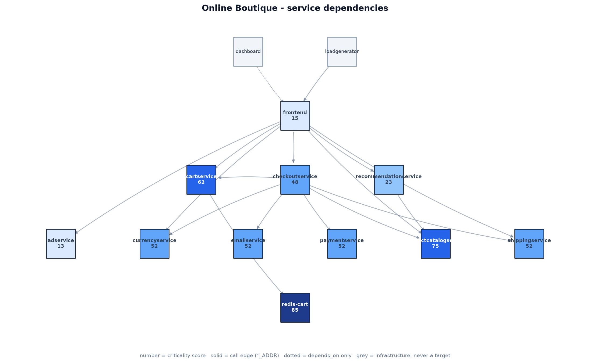

# Bosch Hackathon: AI-Driven Chaos Engineering

An AI system that plans, injects and analyzes controlled failures in a cloud-native sample app (Online Boutique) to improve its resilience.

## What it does

1. **Maps** the application automatically: it reads the Compose file's service wiring and builds a dependency graph, scoring each service by how much of the system sits behind it.
2. **Monitors** continuously: HTTP probes (including a synthetic checkout), container health, CPU and memory, and Docker lifecycle events, written to `results/` every two seconds.
3. **Injects** controlled failures: a crash, a lasting outage, a frozen (unresponsive) service, or a traffic spike.
4. **Stops itself** when an experiment does too much damage: the watchdog aborts and rolls back on error rate, latency, blast radius or lost monitoring, and anyone can force a stop.
5. **Measures** what happened: time to detect, time to recover, which pages failed, and how error rate and latency moved against the baseline.

Day 2 adds the AI planner (which experiment to run next, and why) and the analyst (ranked findings with recommended fixes). The interfaces they plug into already exist: `schemas.Experiment` in, `schemas.ExperimentResult` out.

## Architecture



```
                 target.yaml  (allow-list, thresholds, duration cap)
                      |
  mapper/  ---------> |                          app/      Online Boutique under test
  dependency graph    v                            ^
                 safety/   <-- the gate            | docker kill / stop / pause
                      |   validate -> watch        |
  planner/  ------>   |                        injector/   actions + rollback
  (day 2)        orchestrator/  ---------------->  |
                      |   run the experiment       |
                      v                            v
                 results/   <----------------  monitor/   probes, telemetry, dashboard
                 telemetry, baseline, per-experiment records
```

**How the AI makes decisions (day 2).** The planner receives the dependency graph (with criticality scores and the reason for each) and the results of earlier experiments, and proposes the next `Experiment`. It never touches Docker: every plan it produces goes through `safety.validate_plan` first.

**Safety controls.** See [Safety controls](#safety-controls) below. The short version: the planner can propose anything, and a deterministic layer decides what actually runs.

Modules: `app/` (the system under test), `mapper/` (dependency graph), `monitor/` (telemetry, baseline, dashboard), `injector/` (failure actions and rollback), `safety/` (validation, watchdog, kill switch, crash recovery), `orchestrator/` (runs experiments), `planner/` (AI experiment planning, day 2), `results/` (all output).

## Prerequisites

- Docker Desktop (4 GB+ RAM allocated)
- Git
- Python 3.11+

## Setup (clean machine)

```powershell
git clone https://github.com/TejasveerSingh3010/bosch-hackathon.git
cd bosch-hackathon
scripts\setup.bat
copy .env.example .env
```

`scripts\setup.bat` creates `.venv` and installs `requirements.txt`. Everything below assumes you are in the repo root.

## Run the sample app

```powershell
scripts\app-up.bat
```

Starts the 12 Online Boutique containers from `app/docker-compose.yml` and waits for `http://localhost:8080` to answer. `loadgenerator` provides steady background traffic, which is what the baseline is measured under. `scripts\app-down.bat` stops it all.

## Run the monitoring

```powershell
scripts\monitor.bat
```

Opens two windows: the headless monitor (writes telemetry every 2 s) and the dashboard at `http://localhost:8501`. Leave both running.

Then, after about five minutes of steady traffic, capture the baseline every experiment is compared against:

```powershell
scripts\baseline.bat
scripts\status.bat      :: confirms telemetry is fresh and a baseline exists
```

See [monitor/README.md](monitor/README.md) for the telemetry format and every option.

## Build the dependency map

```powershell
scripts\map.bat
```

Writes `results/graph.json` and `docs/dependency_graph.png`, and prints the criticality ranking. The map is derived from the Compose file's `*_ADDR` environment variables (the real call edges) and cross-checked against the upstream architecture diagram, so a mismatch is reported rather than silently accepted.

## Run an experiment

```powershell
:: see what can be targeted, and what the safety layer allows
python -m orchestrator targets

:: validate a plan without changing anything
scripts\experiment.bat adservice kill 20 --dry-run

:: run it for real
scripts\experiment.bat adservice kill 20

:: or from a plan file (the shape the day-2 planner produces)
python -m orchestrator run docs\experiment.example.json
```

Failure modes (`python -m orchestrator actions`):

| Action | What it does | What it tests |
|---|---|---|
| `kill` | SIGKILL the container | Automatic recovery — Compose's `restart: unless-stopped` should bring it back |
| `stop` | Stop the container | Behaviour during a lasting dependency outage |
| `pause` | Freeze every process in it | An unresponsive dependency: callers hang instead of failing fast |

A traffic spike is the dashboard's **Traffic burst** button (request count and concurrency are configurable).

Each run prints a summary and writes `results/<id>.json` with the timeline, detection and recovery times, per-phase error rates and latencies, and which pages failed.

## Safety controls

The brief asks for controlled failures with automatic limits. Nothing reaches Docker without passing all of this, and none of it calls an LLM:

| Control | Where | Behaviour |
|---|---|---|
| Allow-list | `safety/validator.py` | Only containers listed in `target.yaml` can be targeted |
| Protected infrastructure | `safety/validator.py` | `loadgenerator`, the dashboard and the monitor can never be targeted, even if allow-listed |
| Duration cap | `safety/limits.py` | `target.yaml`'s `max_experiment_seconds`, plus a hard 600 s ceiling no config can raise |
| Threshold clamp | `safety/validator.py` | An experiment may tighten the abort limits but never loosen them |
| Pre-flight check | `safety/validator.py` | Refuses to start if the system is already degraded, a container is unready, or telemetry is stale |
| Automatic abort | `safety/watchdog.py` | Rolls back on error rate, p95 latency, blast radius, or telemetry going stale — two consecutive breaching samples, so one noisy probe is not enough |
| Kill switch | `safety/killswitch.py` | `scripts\stop.bat`, the dashboard's **STOP** button, or Ctrl+C |
| Crash recovery | `safety/journal.py` | The journal is written before injection; `scripts\recover.bat` restores anything a crashed run left behind |
| Idempotent rollback | `injector/actions.py` | Rollback inspects the container and does only what is needed, so it is safe to run twice |

Thresholds live in `target.yaml`:

```yaml
allowed_containers: [...]       # from `docker ps`; loadgenerator deliberately excluded
thresholds:
  error_rate: 0.20              # a fraction; telemetry reports percent, converted in safety/limits.py
  p95_ms: 2000
max_experiment_seconds: 120
```

## Demo

```powershell
scripts\demo.bat
```

Walks through monitoring status, the dependency map, a plan the safety layer refuses, a dry run, then two contrasting experiments: crashing the least critical service, and freezing one on the checkout path.

## Tests

```powershell
scripts\test.bat
```

90 tests covering the safety rules, the watchdog's abort conditions, every action's rollback, the runner's abort and recovery paths, and the mapper. They use a fake Docker (`tests/fake_docker.py`) that models restart policies, so **no Docker and no running app are needed**.

## Tools, AI models and libraries used

| | |
|---|---|
| Sample app | [GoogleCloudPlatform/microservices-demo](https://github.com/GoogleCloudPlatform/microservices-demo) (Online Boutique), Apache-2.0, images pinned to `v0.10.7` |
| Runtime | Docker Compose |
| Language | Python 3.11+ |
| Libraries | pydantic (schema validation), networkx (graph analysis), matplotlib (graph rendering), streamlit (dashboard), requests, PyYAML, locust, pytest, ruff |
| AI models | Day 2 — the planner and analyst (configured through `LLM_API_KEY` in `.env`) |
| AI assistance | Claude (Anthropic) was used while developing this repository |

## Troubleshooting

| Symptom | Fix |
|---|---|
| `telemetry is N seconds old` | The monitor is not running: `scripts\monitor.bat` |
| `not in target.yaml allowed_containers` | Run `python -m orchestrator targets` and copy the real names in |
| `a previous experiment did not finish cleanly` | `scripts\recover.bat` |
| A container is still paused or stopped | `scripts\recover.bat`, or `docker unpause <name>` / `docker start <name>` |
| `streamlit is not recognized` | `scripts\setup.bat` (the root `requirements.txt` includes it) |
| The dashboard and monitor disagree | Only one should write telemetry; `scripts\monitor.bat` sets `BOUTIQUE_DASHBOARD_WRITES=0` for you |

## Scope

Experiments run only against this repository's own Compose stack on the machine they are launched from. Nothing targets a remote, shared or production system.
